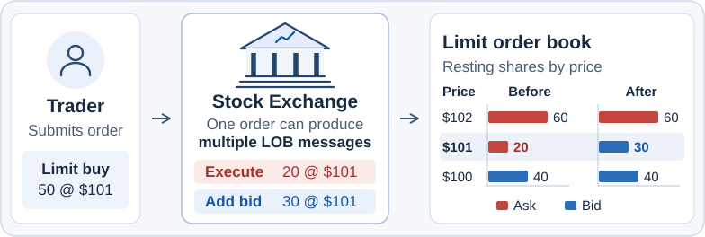
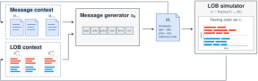

To understand how LOB message generation can support a market world model, we first look at how orders and messages shape the order book.
## Market microstructure: Orders, messages, and the LOB
<figure>
  
</figure>
Markets can be viewed from both macro and micro perspectives. From a micro perspective, stock prices emerge from the interaction of individual buy and sell orders. The figure illustrates this microstructure view of price formation. 

1. A trader submits a limit buy for 50 shares at \$101.
2. The exchange matches 20 shares against an existing sell order at \$101 and records an `execute` message. It adds the remaining 30 shares to the book as a new buy order and records an `add` message.
3. The highest buy price in the book rises from \$100 to \$101, while the lowest sell price rises from \$101 to \$102.

We now describe the process illustrated above more precisely by defining orders, messages, and the limit order book. An **order** is
$$
\mathrm{order} = (\mathrm{action},\mathrm{side},\mathrm{price},\mathrm{quantity}),
$$
where $\mathrm{action}$ is `add` or `cancel`, and $\mathrm{side}$ is `buy` or `sell`.

As the exchange processes orders, events such as additions, cancellations, and executions are recorded as **messages**. We refer to these order-level records as **LOB messages**, available through [LOBSTER](https://php.lobsterdata.com/index.php)’s message files and [Databento](https://databento.com/docs/schemas/mbo)’s **market-by-order (MBO) data**:
$$
\mathrm{message}
=
(\mathrm{time},\mathrm{action},\mathrm{side},\mathrm{order\_id},\mathrm{price},\mathrm{quantity}),
$$

where $\mathrm{action}$ is `add`, `cancel`, or `execute`. The $\mathrm{order\_id}$ is the exchange-assigned identifier of the affected order.

The **limit order book (LOB)** contains outstanding orders and their remaining quantities. Each message updates this book according to the exchange’s rules:
$$
\mathrm{LOB}_n
=
\mathrm{Update}(\mathrm{LOB}_{n-1},\mathrm{message}_n).
$$

## LOB message generation as a market world model

<figure>
  
  <figcaption>Closed loop market simulation with LOB message generator and LOB simulator</figcaption>
</figure>

A LOB message generator and a LOB simulator form a closed loop for market simulation.
1. **Generate a message.** Given the history of messages and LOB states, $\pi_\theta$ generates the next message.
2. **Update the book and history.** Apply the message to the LOB and append the message and updated LOB to their respective histories. Repeat from step 1 with the updated history.

When an agent submits an order, the simulator processes it and the generator models the market activity that follows. Together, they can serve as a **market world model**.

- **An RL environment for trading agents.** The agent submits an order, observes the updated market state, and receives a reward based on the simulated outcome. For example, an execution agent can learn to minimize the cost of buying a fixed quantity by a deadline.
- **What-if analysis of market impact.** Starting from the same market state, we can compare simulated mid-price paths with and without the agent’s order to estimate its impact.