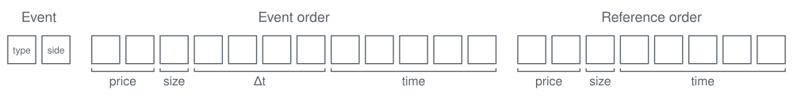
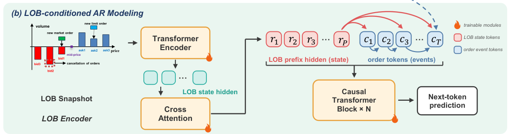
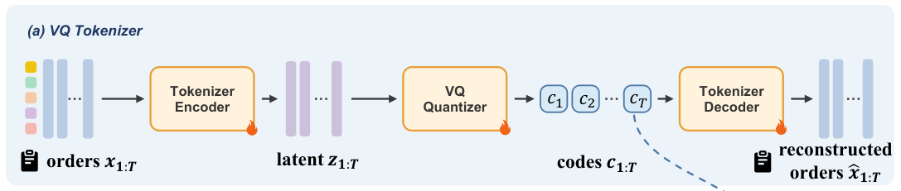

In the [previous post](/blog/lob-message-generation-market-world-models), we looked at why LOB message generation matters for finance. Here, we introduce existing generation methods, grouped by the unit the model generates at each step:

- **Field-wise generation (LOBS5):** generates a message one field token at a time.
  - Lossless except for clipping, and each token is interpretable.
  - Each message takes many positions, so the context covers a short history.
- **Message-wise generation (M3):** generates a whole message at each step, and a decoder or projection head recovers the fields.
  - Each message takes one position, so the context covers a long history.
  - Recovering the fields from a message-level output can be lossy.

---
## LOBS5: Field-wise generation

Nagy et al.'s *Generative AI for End-to-End Limit Order Book Modelling*[^lobs5] provides a direct starting point. LOBS5 uses an S5 state-space model to generate message tokens autoregressively, conditioned on message and book history. 

### Message representation
Each message spans **22 discrete tokens** describing fields such as event type, side, price, size, time, and reference attributes. All fields **share a vocabulary of 12,011 tokens**, including three special tokens. For new-order additions, no existing order is referenced, so the reference-order fields are filled with `<NA>` tokens. A training sequence of 500 messages therefore spans 11,000 positions.[^lobs5]

- **Price:** $\mathrm{price}\rightarrow(\mathrm{sign}(\Delta\mathrm{price}),|\Delta\mathrm{price}|)$  
  $\Delta\mathrm{price}$ is the tick offset from the tick-aligned mid-price, clipped to $[-999,999]$.
- **Quantity:** $\mathrm{quantity}\rightarrow\min(\mathrm{quantity},9999)$
- **Inter-arrival time:** $\Delta\mathrm{time}\rightarrow(\mathrm{seconds},\mathrm{ns}_1,\mathrm{ns}_2,\mathrm{ns}_3)$  
  The nanosecond component is split into three-digit groups.

### Related work

- **MarketGPT**[^marketgpt] uses a decoder-only Transformer to generate tokenized messages from message histories.
- **sigma-0**[^sigma0] increases the message length from 22 to 24 tokens by splitting prices into base-100 chunks. A later version uses 26 tokens per message, but the available documentation does not specify which fields account for the increase from 24 to 26.
- **ByteGen**[^bytegen] goes below fields: it predicts the raw 32-byte event, including absolute price, nanosecond timestamp, and order ID, one byte at a time. It trains on sequences of 100–320 events.
---
## M3: Message-wise generation

M3 places each order at **one sequence position** by tokenizing it into one discrete token. Causal Transformer blocks then predict each next order token, conditioned on a prefix that encodes the initial LOB. A decoder translates generated tokens back into order fields, but this round trip is lossy.[^m3]

<figure>
  
  <figcaption>Source: <a href="https://arxiv.org/html/2608.19227v1#Sx1.F2">M3, Figure 2(b)</a>.</figcaption>
</figure>

### Message representation

Each order is a **five-field vector** of three continuous fields and two binary flags:

$$
\left[\frac{\mathrm{price}-P^{\mathrm{open}}}{P^{\mathrm{open}}},\ \log(1+\mathrm{quantity}),\ \Delta\mathrm{time},\ \mathrm{event\ type},\ \mathrm{side}\right]
$$

Event type is `add` or `cancel`, and side is `bid` or `ask`. The continuous fields are clipped at their 0.5th and 99.5th percentiles. 

M3 normalizes prices relative to the daily open so that training and inference use the same price anchor.

- **Why the gap arises.** Lossy order reconstruction can shift the simulated mid-price, changing the reference used to decode the next order’s price.
- **Trade-off.** Prices relative to the daily open span a wider range because they also reflect intraday price movements.[^m3]

The learned tokenizer maps each order to **one of 32,768 discrete codes** and is trained to reconstruct the order using the following steps.[^m3]

1. **Encode.** A causal encoder maps the order and its history to a latent vector, $z_t = E(x_{\le t})$.
2. **Select a code.** Find the codebook vector closest to $z_t$. Its index is the order token, $c_t = \arg\min_k \lVert z_t - e_k \rVert_2^2$.
3. **Look up the vector.** Retrieve the vector stored at index $c_t$. This quantized vector is $q_t = e_{c_t}$.
4. **Decode.** A causal decoder reconstructs the order fields from the quantized vectors, $\hat{x}_t = D(q_{\le t})$.

The tokenizer loss has four terms.

$$
L_{\mathrm{tokenizer}}
= L_{\mathrm{continuous}} + L_{\mathrm{categorical}}
+ \underbrace{0.25\lVert z_t-\operatorname{sg}(q_t)\rVert_2^2}_{\mathrm{commitment}}
+ 0.001 L_{\mathrm{tick}}.
$$
<figure>
  
  <figcaption>Source: <a href="https://arxiv.org/html/2608.19227v1#Sx1.F2">M3, Figure 2(a)</a>.</figcaption>
</figure>

### Limitations

- **Lossy representation.** Of the reconstructed prices, 37.7% match the original price exactly and 66.2% are within one tick.[^m3]
- **Stale prefix in long rollouts.** M3 trains on windows of at most 1,024 orders, each starting right after its LOB snapshot. Longer rollouts keep the initial prefix but drop the oldest orders, so the prefix no longer matches the start of the window, a combination never seen in training.[^m3]

### Related work

- **MarS**[^mars] also generates one token per order, but its token indexes a fixed grid of type, price, volume, and interval bins. A separate model generates minute-level order distributions that steer the order-level generator.
- **LOBERT**[^lobert] represents each message at one position as a hand-binned token plus continuous price and volume features, and predicts fine values with regression heads. It evaluates next-message prediction rather than long rollouts.
- **TRADES**[^trades] also places each order at one position, but instead of quantizing it into a token, it generates the normalized field values directly with a conditional diffusion model, conditioned on recent orders and LOB snapshots.
---
## Evaluating LOB message generators

- **LOB-Bench**[^lob-bench] compares the distributions of market statistics in generated and historical order flow to assess how closely the simulations resemble real trading.
- **LOB-Impact**[^lob-impact] injects orders into the simulated market and tests whether the resulting price impact follows patterns observed in real markets, including how impact grows during execution and decays afterward.
---
## Message representations compared

| Model | Positions per message | Vocabulary | Messages in context | Book input |
|---|---|---:|---:|---|
| ***Field-wise generation*** | | | | |
| ByteGen[^bytegen] | 32 bytes | 256 | 100–320 | — |
| LOBS5[^lobs5] | 22 tokens | 12,011 | 500 | LOB state per message |
| MarketGPT[^marketgpt] | 24 tokens | 12,111 | 432 | — |
| ***Message-wise generation*** | | | | |
| M3[^m3] | 1 learned code | 32,768 | 1,024 | Initial LOB prefix only |
| MarS[^mars] | 1 binned token | 49,152 | 1,024 | LOB volumes and mid-price per order |
| LOBERT[^lobert] | 1 binned token + continuous values | 293 | 512 | Optional LOB snapshot per message |
| TRADES[^trades] | 1 continuous 8-D vector | — | 255 | LOB snapshot per order |

## References

[^lobs5]: [Generative AI for End-to-End Limit Order Book Modelling](https://arxiv.org/abs/2309.00638), Sections 3–6.

[^marketgpt]: [MarketGPT](https://arxiv.org/abs/2411.16585), Materials and Methods; [simulation code](https://github.com/aaron-wheeler/marketgpt/blob/070c3ad6d10877fcb9651ba9f7affefdbf68320c/scripts/simulate.py#L424-L523), commit `070c3ad`.

[^m3]: [M3: A State-Event Generative Foundation Model for Market Microstructure Dynamics](https://arxiv.org/html/2608.19227v1), Sections 3–4 and Appendices B–D.

[^lobert]: [LOBERT: Generative AI Foundation Model for Limit Order Book Messages](https://arxiv.org/html/2511.12563v2), Sections 2.1, 2.3, and 3.2 and Appendix B.

[^trades]: [TRADES: Generating Realistic Market Simulations with Diffusion Models](https://arxiv.org/html/2502.07071v3), Figure 1 and Sections 4.2 and 5; supplementary material, Section 3.

[^lob-bench]: [LOB-Bench: Benchmarking Generative AI for Finance – an Application to Limit Order Book Data](https://arxiv.org/abs/2502.09172).

[^lob-impact]: [LOB-Impact Benchmark: Emergent Market Impact in Generative Limit Order Book Models](https://arxiv.org/abs/2610.27100).

[^sigma0]: [sigma-0 project notes](https://kangoxford.github.io/sigma0/), Q12, and [sigma-0 synthetic LOB order flow, release 3a](https://huggingface.co/datasets/oxford-lob/sigma-0-synthetic-messages), dataset card.

[^bytegen]: [ByteGen: A Tokenizer-Free Generative Model for Orderbook Events in Byte Space](https://arxiv.org/abs/2508.02247), Sections 3.1 and 4.2 and Appendix A.1.

[^mars]: [MarS: a Financial Market Simulation Engine Powered by Generative Foundation Model](https://arxiv.org/abs/2409.07486), Appendices B–D.
