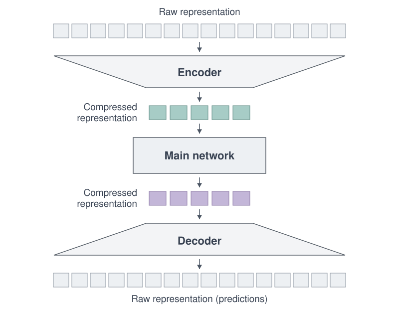
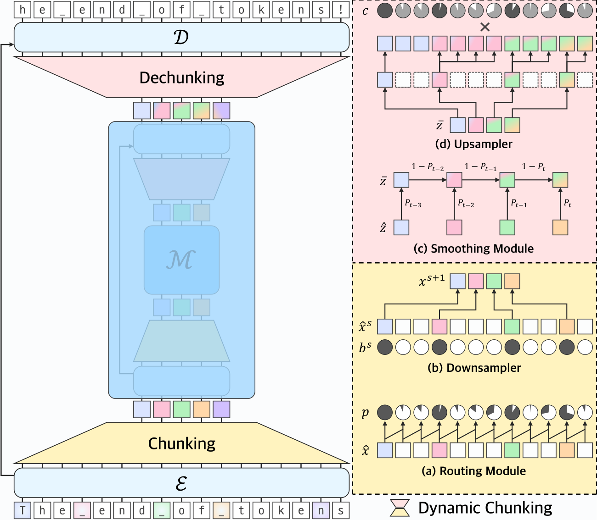
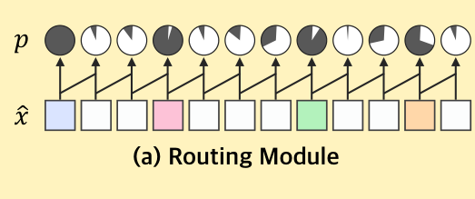
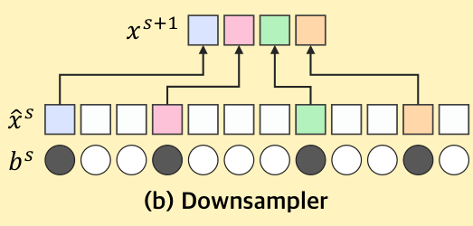
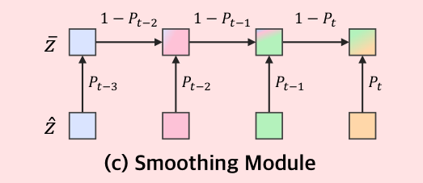
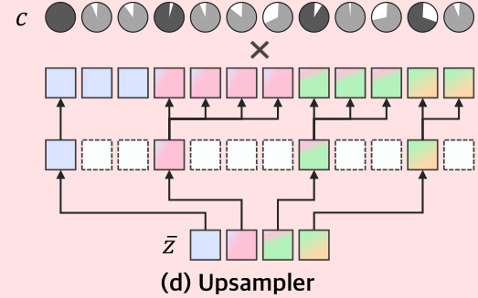

## LH-Net and H-Net
The previous post explored the motivation behind H-Net and what it can do. In this post, we turn to *Dynamic Chunking for End-to-End Hierarchical Sequence Modeling*[<a href="#ref-1">1</a>] to understand *how it works*.

Following [Cartesia’s distinction](https://www.cartesia.ai/blog/from-tokens-to-bytes-part-1#aside-how-does-this-compare-to-the-original-h-net), we call the original model **LH-Net**, where “L” stands for “lazy” or “lookahead.” Although Cartesia has not disclosed the full architectural details of the updated H-Net, it highlights a key difference: LH-Net draws a boundary only after seeing the start of the next chunk. This gives it more context for chunking, but, according to Cartesia, hurts next-byte prediction. While LH-Net differs from the H-Net discussed in the previous post, studying it provides a technical foundation for understanding hierarchical sequence modeling.

---
## A lens for understanding sequence modeling

We can view tokenization and learned compression methods through a shared frame: *encode raw inputs into a shorter sequence, process it with a main network, and decode the result into raw-level predictions*. They differ in how they construct these compressed representations—and which parts of this process are learned jointly with the main network. Keeping this picture in mind, we will first look at earlier approaches, then examine how LH-Net learns to form and use these representations.

<figure>
  
  <figcaption style="font-size: 0.8rem; line-height: 1.5; font-weight: 400; color: hsl(var(--muted-foreground, 0 0% 45%)); max-width: 768px; margin: 0.4rem auto 0; text-align: center;">A conceptual view of sequence modeling. Encoder and decoder denote transformations, not necessarily learned networks; compression refers to sequence length.</figcaption>
</figure>

Viewed through this lens, BPE and the prior approaches discussed in the paper differ in how they construct compressed representations and choose their boundaries. The limitations below follow the paper’s discussion.

| Approach | How compression works | Limitation |
| --- | --- | --- |
| BPE[<a href="#ref-3">3</a>] | Merge bytes into vocabulary tokens. | Segmentation stays fixed during language-model training. |
| Direct byte modeling (MambaByte[<a href="#ref-4">4</a>]) | — | Processing the full byte sequence remains costly. |
| Fixed-size chunking (Hourglass[<a href="#ref-5">5</a>], MegaByte[<a href="#ref-6">6</a>]) | Encode each group of $k$ bytes into a single representation. | Boundaries do not adapt to content. |
| Heuristic chunking (SpaceByte[<a href="#ref-7">7</a>], BLT[<a href="#ref-8">8</a>]) | Form chunks using delimiter or entropy rules. | The boundary-selection rule may not align with the main objective. |
| End-to-end chunking (DPT’s Gumbel variant[<a href="#ref-9">9</a>]) | Learn chunk boundaries jointly with next-token prediction. | Training instability limits scaling and deeper hierarchies. |

<strong>Note.</strong> Entropy rules place boundaries where uncertainty about the next byte is high or rises sharply.

LH-Net follows the same end-to-end direction as the last approach, with architectural and training changes designed to make learned chunking stable and scalable across model sizes and hierarchy levels.

---
## LH-Net architecture overview
LH-Net follows an encoder → chunking layer → main network → dechunking layer → decoder structure. During autoregressive generation, the encoder and decoder run at every byte, while the main network advances only when a new chunk boundary is selected.

Crucially, *the main network can itself be another LH-Net*, allowing the same structure to repeat across multiple levels of compression. The paper’s Figure 1 shows a two-stage example. For simplicity, this post focuses on a single-stage architecture with one encoder, one main network, and one decoder.

<figure>
  
  <figcaption style="font-size: 0.8rem; line-height: 1.5; font-weight: 400; color: hsl(var(--muted-foreground, 0 0% 45%)); margin: 0.4rem auto 0; text-align: center;">Two-stage architecture (left) and dynamic chunking components (right). Source: Hwang et al., Figure 1.[<a href="#ref-1">1</a>]</figcaption>
</figure>

The architecture and its learning objective can be understood through the following principles:

- **Keep the encoder and decoder efficient.** Since the encoder and decoder process long, uncompressed sequences, they use efficient state space models: four Mamba-2 layers in each encoder and decoder.
- **Preserve fine-grained information for the decoder.** The encoder passes fine-grained information through residual connections.
- **Concentrate compute and model capacity in the main network.** The main network operates on a shorter sequence of richer representations. The encoder builds these representations, and the chunking layer reduces the sequence length.
- **Use next-byte prediction as the main learning signal, including for chunking.** Learn chunk boundaries that support next-byte prediction, without explicit boundary supervision.

---
## Dynamic chunking

In LH-Net, the encoder preserves sequence length so that the model can decide where to place chunk boundaries before compression. *There are no ground-truth boundary labels*; instead, boundary decisions are learned to improve next-byte prediction.

The **chunking layer** uses a routing module to determine boundaries and a downsampler to construct compressed representations. The **dechunking layer** uses a smoothing module to support stable boundary learning and an upsampler to restore the original sequence length. The decoder then processes these full-length representations to predict the next byte at each position.

### Chunking layer

For a single hierarchy level, the encoder first produces a representation at every input position, then the chunking layer returns a shorter sequence and routing scores:

$$
\hat{x}=\mathcal{E}(x),
\qquad
(x_{\mathrm{chunk}},p)=\operatorname{Chunk}(\hat{x}).
$$

#### Routing module
<figure>
  
</figure>

The **routing module** builds on the intuition that *meaningful boundaries tend to occur where context or meaning shifts*. Each encoder output $\hat{x}_t$ represents $x_t$ in the context of $x_{<t}$. The router compares learned projections of adjacent representations to detect these shifts:

$$
p_t = \frac{1}{2}\left(
1-\frac{q_t^\top k_{t-1}}{\|q_t\|\|k_{t-1}\|}
\right),
\qquad
b_t = \mathbf{1}[p_t \geq 0.5].
$$
Here, $q_t$ and $k_t$ are learned projections of the encoder output $\hat{x}_t$. The binary indicator $b_t$ determines whether the current position starts a new chunk. The first position is always selected, with $p_1=1$.

#### Downsampler

<figure>
  
</figure>

The **downsampler** constructs a compressed sequence using the boundaries selected by the routing module. LH-Net selects encoder outputs at boundary positions, rather than pooling the representations within each chunk. The same selection is applied to the routing scores: retaining only the boundary positions from $p$ produces $P$, which is passed to the smoothing module during dechunking.

### Dechunking layer

The dechunking layer takes the main network output $\hat{z}=\mathcal{M}(x_{\mathrm{chunk}})$ and the routing scores $p$, restores the sequence length, and adds the encoder residual before decoding: $z=\operatorname{Dechunk}(\hat{z},p)+\operatorname{Linear}(\hat{x})$. 
The dechunking components are designed to provide a learning signal for chunk boundary decisions. This requires gradients with respect to the routing scores $p_t$.

#### Smoothing module

<figure>
  
</figure>

The **smoothing module** blends the main network’s output $\hat{z}_t$ with the previous smoothed representation using the boundary probability $P_t$, and passes the result to the upsampler.
$$
\bar{z}_t=P_t\hat{z}_t+(1-P_t)\bar{z}_{t-1}.
$$

Here, $t$ indexes the compressed sequence rather than the original byte sequence.

The smoothing module serves three roles:

- **Boundary learning:** provide a differentiable path from the prediction loss to the routing scores.
- **Error correction:** soften the effect of uncertain boundaries by incorporating information from preceding chunks.
- **Training stability:** reduce early commitment to suboptimal chunking patterns.

#### Upsampler

<figure>
  
</figure>

The upsampler restores the original sequence length by repeating each smoothed chunk representation until the next boundary:
$$
\tilde{z}_t=\bar{z}_{\sum_{k=1}^{t} b_k}.
$$

It then weights the result by the router's confidence in the current decision, $c_t=p_t^{b_t}(1-p_t)^{1-b_t}$, passed through a straight-through estimator $\mathrm{STE}(c_t)=c_t+\mathrm{sg}(1-c_t)$:
$$
u_t=\operatorname{STE}(c_t)\cdot\tilde{z}_t.
$$

Here, $\mathrm{sg}$ denotes stop-gradient. The STE sets the multiplier to one in the forward pass, so $u_t=\tilde{z}_t$, but keeps a gradient path to $p_t$. The contribution through this multiplier is:
$$
\left.\frac{\partial\mathcal{L}}{\partial p_t}\right|_{\mathrm{STE}}
=(2b_t-1)\left(\frac{\partial\mathcal{L}}{\partial u_t}\right)^{\!\top}\tilde{z}_t.
$$
When strengthening $\tilde{z}_t$ would lower the loss, this gradient reinforces the current boundary decision; otherwise it weakens it.

---
## Training objective

LH-Net’s objective is next-byte prediction with compression regularization. The prediction loss provides the main learning signal for the entire model, including chunking, while the ratio loss encourages each stage to meet its target compression ratio.
$$
\mathcal{L}
=
\underbrace{-\frac{1}{L}\sum_{t=1}^{L}\log p_{\theta}(x_{t+1}\mid x_{1:t})}_{\text{next-byte prediction}}
+
\alpha\underbrace{\frac{N}{N-1}\left[(N-1)FG+(1-F)(1-G)\right]}_{\text{ratio loss}},
$$
for $F=\frac{1}{L}\sum_{t=1}^{L}b_t$ and $G=\frac{1}{L}\sum_{t=1}^{L}p_t$. $F$ is the fraction of positions selected as boundaries, $G$ is the average routing probability, and $N$ is the target compression ratio. Under $F=G$, the ratio loss is minimized at $F=G=1/N$; when $F\neq G$, it can fall below this value. For multiple chunking stages, the ratio losses are summed across stages.

## References

<ol class="references">
<li id="ref-1">

[Sukjun Hwang, Brandon Wang, and Albert Gu, *Dynamic Chunking for End-to-End Hierarchical Sequence Modeling* (2025)](https://www.alphaxiv.org/pdf/2507.07955)

</li>
<li id="ref-2">

[Cartesia Research, *From tokens to bytes I: Scaling hierarchical networks* (2026)](https://www.cartesia.ai/blog/from-tokens-to-bytes-part-1#aside-how-does-this-compare-to-the-original-h-net)

</li>
<li id="ref-3">

[Rico Sennrich, Barry Haddow, and Alexandra Birch, *Neural Machine Translation of Rare Words with Subword Units* (ACL 2016)](https://aclanthology.org/P16-1162/)

</li>
<li id="ref-4">

[Junxiong Wang et al., *MambaByte: Token-free Selective State Space Model* (2024)](https://arxiv.org/abs/2401.13660)

</li>
<li id="ref-5">

[Piotr Nawrot et al., *Hierarchical Transformers Are More Efficient Language Models* (Findings of NAACL 2022)](https://aclanthology.org/2022.findings-naacl.117/)

</li>
<li id="ref-6">

[Lili Yu et al., *MEGABYTE: Predicting Million-byte Sequences with Multiscale Transformers* (2023)](https://arxiv.org/abs/2305.07185)

</li>
<li id="ref-7">

[Kevin Slagle, *SpaceByte: Towards Deleting Tokenization from Large Language Modeling* (2024)](https://arxiv.org/abs/2404.14408)

</li>
<li id="ref-8">

[Artidoro Pagnoni et al., *Byte Latent Transformer: Patches Scale Better Than Tokens* (2024)](https://arxiv.org/abs/2412.09871)

</li>
<li id="ref-9">

[Piotr Nawrot et al., *Efficient Transformers with Dynamic Token Pooling* (ACL 2023)](https://aclanthology.org/2023.acl-long.353/)

</li>
</ol>

