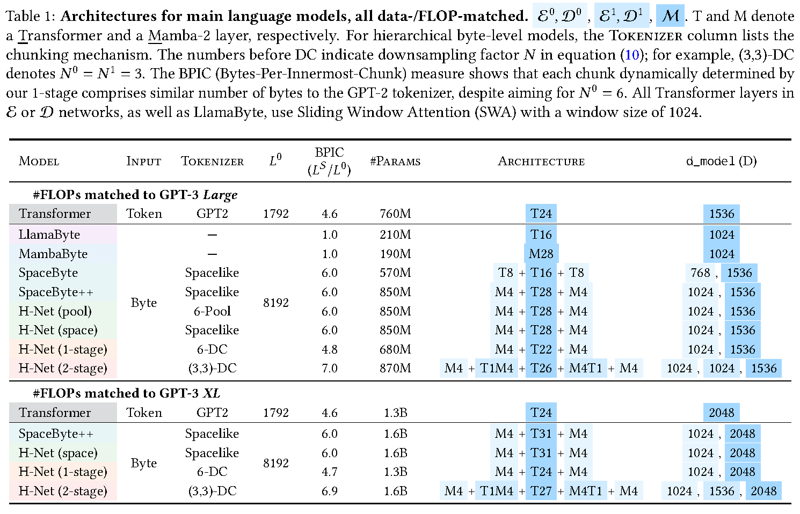
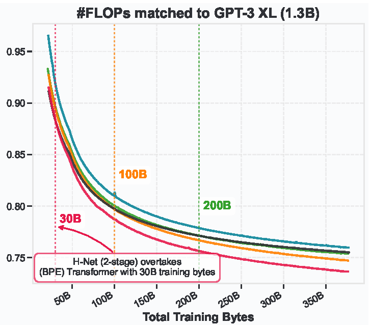
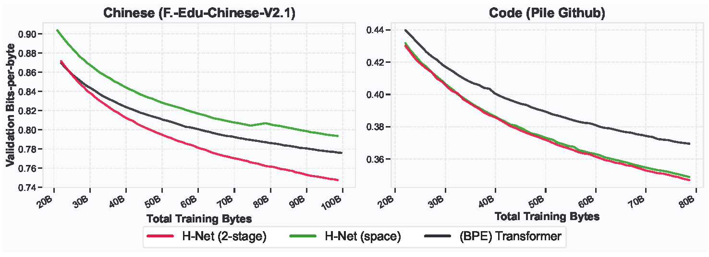
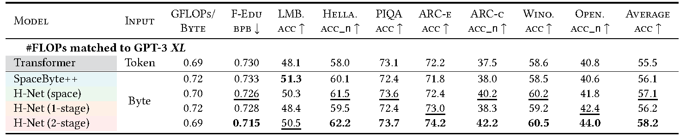
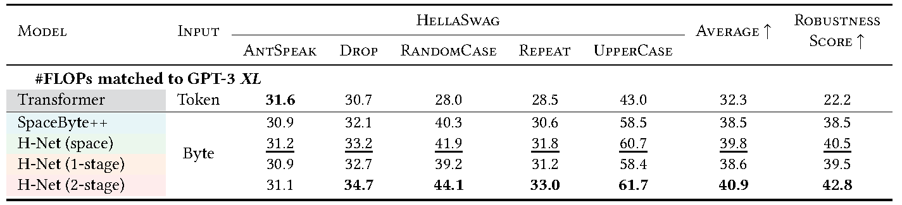

The previous post examined how LH-Net learns chunk boundaries. This post turns to the experimental design and training practices in *Dynamic Chunking for End-to-End Hierarchical Sequence Modeling*[<a href="#ref-1">1</a>], asking how the comparisons isolate the benefits of hierarchy, learned chunking, and training choices.

## Experimental design

The experiments examine four design choices in LH-Net: **(i) network architecture, (ii) training recipe, (iii) dynamic chunking, and (iv) hierarchy depth**. To compare models that process BPE tokens, individual bytes, or chunks of different lengths, the authors match both **bytes per batch** and **training FLOPs per byte**.

- **Architecture**
  - `SpaceByte` uses Transformer layers in the encoder, main network, and decoder.
  - `SpaceByte++` uses Mamba-2 in the encoder and decoder and a deeper Transformer in the main network.

  
<strong>Training recipe</strong> (Section 2.3)

  <ul>
  <li><strong>Norm balance.</strong> RMSNorm at the end of each encoder, decoder, and main network keeps the deeper network’s output from overwhelming the encoder’s residual signal when the two are added.</li>
  <li><strong>Separation of two streams.</strong> A linear projection on the encoder-to-decoder skip connection lets the encoder features adapt to the decoder while preserving the direct path into the next stage.</li>
  <li><strong>Learning rate modulation.</strong> Outer stages process more positions per batch and use higher learning rates, with the multiplier accounting for both sequence length and hidden width.</li>
  </ul>

<ul style="margin-inline-start: 1.5em;">
  <li><code>SpaceByte++</code> uses the baseline training recipe.</li>
  <li><code>LH-Net (space)</code> adds the training changes from Section 2.3.</li>
</ul>

- **Chunking boundaries**
  - `LH-Net (pool)` starts a new chunk every six bytes.
  - `LH-Net (space)` uses space-like delimiters.
  - `LH-Net (1-stage)` learns where to split.

- **Hierarchy depth**
  - `LH-Net (1-stage)` learns to group bytes into chunks.
  - `LH-Net (2-stage)` also learns to group those chunks into larger units.

## Results

We focus on the XL models, which share the training compute budget of the 1.3B-parameter token-level Transformer.

### LH-Net overtakes the token-level Transformer as training progresses

On English text, two-stage LH-Net overtakes the BPE Transformer after about 30B training bytes.

<figure>
  
  <figcaption style="width: 60%; font-size: 0.8rem; line-height: 1.5; font-weight: 400; color: hsl(var(--muted-foreground, 0 0% 45%)); margin: 0.4rem auto 0; text-align: left;">Two-stage LH-Net (red), space-based LH-Net (green), and the BPE Transformer (black). Validation bits per byte on English at XL scale (lower is better). Source: Hwang et al., Figure 3, right panel.[<a href="#ref-1">1</a>]</figcaption>
</figure>

On Chinese text, two-stage LH-Net overtakes the BPE Transformer after about 25B training bytes. On code, it leads throughout the interval shown.

<figure>
  
  <figcaption style="font-size: 0.8rem; line-height: 1.5; font-weight: 400; color: hsl(var(--muted-foreground, 0 0% 45%)); margin: 0.4rem auto 0; text-align: left;">XL validation bits per byte on Chinese text (left) and code (right). Source: Hwang et al., Figure 5.[<a href="#ref-1">1</a>]</figcaption>
</figure>

### Two-stage LH-Net achieves the highest average accuracy on clean and perturbed inputs

<figure>
  
  <figcaption style="font-size: 0.8rem; line-height: 1.5; font-weight: 400; color: hsl(var(--muted-foreground, 0 0% 45%)); margin: 0.4rem auto 0; text-align: left;">Zero-shot accuracy on seven tasks at XL scale. Two-stage LH-Net leads on six tasks and averages 58.2%. SpaceByte++ leads on LAMBADA. Source: Hwang et al., Table 2 (XL rows).[<a href="#ref-1">1</a>]</figcaption>
</figure>

<figure>
  
  <figcaption style="font-size: 0.8rem; line-height: 1.5; font-weight: 400; color: hsl(var(--muted-foreground, 0 0% 45%)); margin: 0.4rem auto 0; text-align: left;">HellaSwag accuracy under five text perturbations at XL scale. Two-stage LH-Net achieves the highest average accuracy (40.9%) and robustness score (42.8). Source: Hwang et al., Table 3 (XL rows).[<a href="#ref-1">1</a>]</figcaption>
</figure>

For examples of how LH-Net groups text into chunks, see [the examples in Part 1](/blog/learning-to-tokenize-1#observed-chunking-behaviors).

## References

<ol class="references">
<li id="ref-1">

[Sukjun Hwang, Brandon Wang, and Albert Gu, *Dynamic Chunking for End-to-End Hierarchical Sequence Modeling* (2025)](https://www.alphaxiv.org/pdf/2507.07955)

</li>
</ol>
