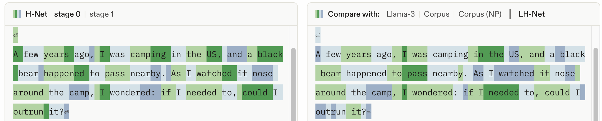
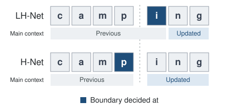

In this post, we’ll use clues from [Cartesia’s blog](https://www.cartesia.ai/blog/from-tokens-to-bytes-part-1#aside-how-does-this-compare-to-the-original-h-net) to explore how `H-Net` differs from `LH-Net`. Cartesia calls the original model `LH-Net`, where the L stands for *lazy* or *lookahead*. `LH-Net` marks a boundary **after reading the first byte of the next chunk**. Cartesia’s description suggests that `H-Net` closes the current chunk **when it reads its last byte**. Let’s compare how the two models split the same passage.

<figure>
  
  <figcaption style="font-size: 0.8rem; line-height: 1.5; font-weight: 400; color: hsl(var(--muted-foreground, 0 0% 45%)); margin: 0.4rem auto 0; text-align: left;">Stage 0 chunking by H-Net (left) and LH-Net (right). Each colored span is one chunk. Adapted from <a href="https://www.cartesia.ai/blog/from-tokens-to-bytes-part-1#fig-10a">Cartesia, Figure 10a</a>.</figcaption>
</figure>

| Observation | H-Net | LH-Net |
| --- | --- | --- |
| Whitespace | Spaces often end a chunk in this passage. | Spaces often start a chunk in this passage. |
| Word structure | `camp\|ing`, `happen\|ed` | `camping`, `happened` |
| Split before the final letter | — | `mas\|s`, `Ove\|r` |

Cartesia argues that waiting gives `LH-Net` more context for chunking but hurts next-byte prediction. I think this comes down to the timing of the main context update. `LH-Net` updates its main context only after reading the first byte of a new chunk, so the updated context is first available when predicting the second byte. This means `LH-Net` always predicts the first byte with the previous main context, which may matter because that byte can be an important clue to the new chunk’s meaning. The figure below illustrates this timing with the hypothetical split `camp|ing`.

<figure style="max-width: 470px; margin-inline: auto;">
  
  <figcaption style="font-size: 0.8rem; line-height: 1.5; font-weight: 400; color: hsl(var(--muted-foreground, 0 0% 45%)); margin: 0.4rem auto 0; text-align: left;">With the same hypothetical split, H-Net’s inferred update after <code>p</code> can help predict <code>i</code>. LH-Net updates after reading <code>i</code>, in time to predict <code>n</code>.</figcaption>
</figure>

Therefore, a linguistically natural boundary delivers lagged context for the next chunk generation, which may harm the next byte generation. This can explain two patterns in the examples above.
- If `ng` is already predictable after `i`, splitting `camp|ing` may offer little benefit over keeping `camping` intact.
- If the meaning of `mass` helps predict what comes next, splitting `mas|s` lets the final `s` trigger an update in time to predict the first byte after the word.

## Chunking mechanism of H-Net
The intuition behind `LH-Net` is that a sharp change between adjacent encoder representations signals the start of a new chunk. To detect that change, the model must read the first byte **beyond the boundary**.

`H-Net` appears to decide when the current chunk ends. This may seem counterintuitive at first, but with enough context, we can often tell where a chunk is likely to end before we see the next byte. Consider two prefixes that both end in `car`.

- “I parked my car” — Here, `car` already makes sense as a complete word, so closing the chunk at `r` would be natural.
- “The floor was covered with a thick Persian car” — Here, we might expect the word `carpet`, so keeping the chunk open at `r` would be natural.

Cartesia has not disclosed `H-Net`’s chunking mechanism. To narrow down the candidates, we first collect the hints from Cartesia’s posts.

| Hint | Evidence |
| --- | --- |
| Decide the boundary at the chunk’s last byte. | `LH-Net` “draw[s] chunk boundaries only after it sees the start of the next chunk,” which “turns out to negatively impact its ability to perform next-token (byte) prediction.” [Cartesia, Part 1](https://www.cartesia.ai/blog/from-tokens-to-bytes-part-1#aside-how-does-this-compare-to-the-original-h-net) |
| Likely not based on next-byte entropy. | With both boundary models trained separately and frozen, entropy-based boundaries had higher validation BPB than boundaries from a smaller `H-Net`’s encoder at all three compute budgets. [Cartesia, Table 2](https://www.cartesia.ai/blog/from-tokens-to-bytes-part-2#how-much-does-end-to-end-training-help) |
| Boundaries tend to follow morpheme boundaries, even inside words. | `H-Net` closes chunks at `camp\|ing` and `happen\|ed`, and whitespace often ends a chunk. [Cartesia, Figure 10a](https://www.cartesia.ai/blog/from-tokens-to-bytes-part-1#fig-10a) |
| Boundaries can align with a repeated unit. | As `LURD` repeats, stage 0 increasingly groups all four letters into one chunk ending at `D`. [Cartesia, Figure 11](https://www.cartesia.ai/blog/from-tokens-to-bytes-part-1#fig-11) |
### Potential candidates

From these hints, we can speculate about how `H-Net` chunks. The most promising candidate keeps `LH-Net`’s cosine routing but changes what $b_t=1$ means: the last byte of the current chunk rather than the first byte of the next one. If the router learns to fire at that byte, the boundary is decided before the next chunk is read, and the main network’s context is updated in time to predict the next chunk’s first byte. We lose `LH-Net`’s original interpretation of a boundary as a change in meaning, but from the perspective of the *bitter lesson*, that may be an unnecessary inductive bias. What drives the router to learn this behavior, rather than `LH-Net`’s, is not disclosed.

Other options seem less likely. Direct prediction from $\hat{x}_t$ performed worse than cosine routing in `LH-Net`’s ablation, although that experiment used the start-of-chunk convention [Original paper, Figure 7](https://arxiv.org/html/2507.07955v2#S4.F7). A fixed threshold on next-byte entropy also seems less likely. Models using boundaries from a separately trained entropy proxy had higher validation BPB than those using boundaries from a frozen `H-Net` encoder. [Cartesia, Table 2](https://www.cartesia.ai/blog/from-tokens-to-bytes-part-2#how-much-does-end-to-end-training-help)
